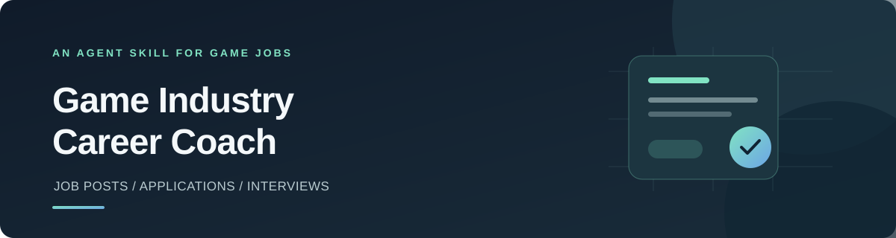

<div align="center">

# 게임업계 취업 코치

**공고 분석부터 서류 작성과 면접 연습까지, Codex와 Claude에서 활용하는 게임업계 취업 스킬**


[주요 기능](#주요-기능) · [설치 방법](#설치-방법) · [사용 예시](#사용-예시) · [저장소 구성](#저장소-구성)

</div>

---

채용 공고를 읽고, 자신의 경험을 정리하고, 지원 서류를 준비하는 과정은 서로 이어져 있습니다. **게임업계 취업 코치**는 이 과정을 돕기 위해 공고의 요구사항과 지원자의 경험을 연결합니다.

게임기획·개발·아트·QA 직무를 지원합니다. 필요한 기능을 하나씩 사용할 수 있으며, 같은 자료를 바탕으로 공고 분석부터 면접 연습까지 이어서 진행할 수도 있습니다.

> **공고 분석 → 서류 진단 → 자기소개서 작성 → 면접 연습**
>
> 상황에 맞는 단계부터 시작하세요.

## 주요 기능

| 기능 | 이렇게 활용할 수 있습니다 |
| --- | --- |
| **채용 공고 분석** | 담당 업무와 필수·우대 조건을 항목별로 살펴보고, 공고에 드러난 업무와 요구 역량을 해석합니다. |
| **이력서·포트폴리오 진단** | 지원 자료를 공고와 대조해 확인된 강점, 부족한 근거와 보완할 부분을 정리합니다. |
| **자기소개서 작성·첨삭** | 실제 문항과 글자 수에 맞춰 경험을 배치하고, 초안 작성과 수정 이유 설명을 돕습니다. |
| **모의 면접** | 공고와 지원 자료를 바탕으로 질문합니다. 답변마다 피드백을 받는 훈련 모드와 종료 후 평가를 받는 실전 모드를 선택할 수 있습니다. |
| **수정본 재검토** | 이전 피드백과 수정본을 비교해 해결된 문제, 남은 문제와 문서 간 불일치를 확인합니다. |
| **취업 준비 계획** | 지원 자격, 마감과 가용 시간을 고려해 준비 작업의 우선순위를 정합니다. |

공고와 지원 자료는 실제로 확인한 범위에서 분석합니다. 자료에 없는 경험이나 성과를 만들어 내지 않으며, 확인할 수 없는 사항은 별도로 표시합니다. 매칭 점수는 요청받았을 때만 산출 기준과 함께 참고용으로 제공합니다.

## 설치 방법

사용하는 환경에 따라 설치 방법과 호출 형식이 다릅니다.

| 환경 | 설치 방법 | 사용 방법 |
| --- | --- | --- |
| **Codex** | `$skill-installer`로 설치하거나 스킬 폴더 복사 | `$game-job-coach`와 함께 요청 |
| **Claude Code** | 개인 또는 프로젝트의 `.claude/skills/`에 스킬 폴더 복사 | `/game-job-coach`와 함께 요청 |
| **Claude 웹·데스크톱 앱** | 스킬 폴더를 ZIP으로 압축해 업로드 | 스킬을 활성화하고 대화에서 사용 요청 |

### Codex에서 설치하기

Codex에 다음과 같이 입력해 `$skill-installer`로 스킬을 설치합니다.

```text
$skill-installer https://github.com/yang-yun-seok/game-job-coach/tree/main/game-job-coach 스킬을 설치해줘.
```

설치가 끝나면 새 대화에서 `$game-job-coach`를 호출할 수 있습니다. 스킬이 목록에 표시되지 않으면 Codex를 다시 시작하세요.

직접 설치하려면 이 저장소의 [`game-job-coach`](game-job-coach) 폴더를 `~/.codex/skills/`에 복사합니다. 복사한 폴더 안에 `SKILL.md`가 있는지 확인하세요.

### Claude Code에서 설치하기

Claude Code가 설치되어 있다면 다음 순서로 스킬을 추가합니다.

1. 저장소를 내려받습니다. GitHub의 **Code → Download ZIP**을 선택했다면 압축을 풉니다.
2. 저장소 안의 **`game-job-coach` 폴더**를 아래 경로 중 하나에 복사합니다. `SKILL.md`, `references`, `assets` 등 폴더 안의 파일을 함께 복사하세요.
3. Claude Code를 시작하고 `/game-job-coach`로 호출합니다.

| 설치 범위 | 복사할 위치 |
| --- | --- |
| 개인용 · macOS/Linux | `~/.claude/skills/game-job-coach/` |
| 개인용 · Windows | `%USERPROFILE%\.claude\skills\game-job-coach\` |
| 특정 프로젝트 | `<프로젝트>/.claude/skills/game-job-coach/` |

복사 후 `game-job-coach/SKILL.md`가 해당 위치에 있어야 합니다. 이미 같은 이름의 스킬이 있다면 기존 내용을 확인한 뒤 교체하세요.

```text
/game-job-coach 이 공고와 내 포트폴리오를 비교해서 개선할 점을 알려줘.
```

위 방법은 로컬 Claude Code 세션에 적용됩니다. 자세한 설치 경로와 호출 방식은 [Claude Code 공식 스킬 문서](https://code.claude.com/docs/en/skills)를 참고하세요.

### Claude 웹·데스크톱 앱에서 설치하기

1. 저장소를 내려받고, 압축 파일이라면 먼저 풉니다.
2. 저장소 안의 **`game-job-coach` 폴더만** ZIP으로 압축합니다. 저장소 전체를 담은 ZIP은 그대로 업로드하지 마세요.
3. Claude의 **Customize → Skills**에서 **+ → + Create skill → Upload a skill**을 선택하고 ZIP을 업로드합니다.
4. 목록에서 스킬을 활성화한 뒤 대화에서 사용을 요청합니다.

ZIP 안에는 다음과 같이 스킬 폴더가 한 단계 들어 있어야 합니다.

```text
game-job-coach.zip
└── game-job-coach/
    ├── SKILL.md
    ├── agents/
    ├── assets/
    └── references/
```

<details>
<summary>명령어로 ZIP 만들기</summary>

저장소를 내려받은 폴더에서 실행하세요.

**Windows · PowerShell**

```powershell
Compress-Archive -LiteralPath .\game-job-coach -DestinationPath .\game-job-coach.zip
```

**macOS/Linux**

```bash
zip -r game-job-coach.zip game-job-coach
```

</details>

```text
게임업계 취업 코치 스킬을 사용해서 이 공고를 분석해줘.
```

스킬 사용에는 코드 실행·파일 생성 기능이 필요합니다. 업로드 메뉴가 보이지 않으면 **Settings → Capabilities**의 **Code execution and file creation** 또는 **Create and edit files** 설정과 조직의 스킬 사용 정책을 확인하세요. 메뉴와 활성화 절차는 [Claude 공식 스킬 사용 안내](https://support.claude.com/en/articles/12512180-use-skills-in-claude), ZIP 구조는 [커스텀 스킬 제작 안내](https://support.claude.com/en/articles/12512198-how-to-create-custom-skills)를 참고하세요.

## 사용 예시

분석할 공고의 링크나 본문, 이력서, 포트폴리오 등 필요한 자료와 함께 원하는 작업을 요청하세요. 자료가 일부만 있어도 확인할 수 있는 범위에서 진행합니다.

아래 예시는 Codex의 호출 형식입니다. **Claude Code에서는 `$game-job-coach`를 `/game-job-coach`로 바꾸고**, Claude 웹·앱에서는 활성화한 스킬의 이름과 함께 같은 작업을 요청하면 됩니다.

**공고 분석**

```text
$game-job-coach 이 공고를 항목별로 분석해줘.
```

**서류 진단**

```text
$game-job-coach 이 공고와 내 포트폴리오를 비교해서 개선할 점을 알려줘.
```

**자기소개서 작성**

```text
$game-job-coach 자기소개서 문항에 맞춰 내 경험을 배치하고 초안을 작성해줘.
```

**모의 면접**

```text
$game-job-coach 이 자료로 실전 면접 7문항을 진행해줘.
```

**수정본 재검토**

```text
$game-job-coach 이전 피드백과 수정본을 비교해줘.
```

반복해서 취업 준비를 진행한다면 [취업 준비 기록 양식](game-job-coach/assets/career-record-template.md)을 작업 폴더에 복사해 공고, 경험, 피드백을 정리할 수 있습니다. 이력서와 포트폴리오 등 개인 자료는 별도로 관리하세요.

## 저장소 구성

```text
.
├── README.md
├── assets/                          # README 배너
└── game-job-coach/                  # 설치할 스킬 폴더
    ├── SKILL.md                     # 공통 원칙과 작업별 지침
    ├── agents/openai.yaml           # 스킬 표시 정보
    ├── assets/                      # 취업 준비 기록 양식
    └── references/                  # 작업별 상세 지침
```

공고 링크와 이미지·PDF의 확인 범위는 실행 환경과 제공된 자료에 따라 달라질 수 있습니다.
